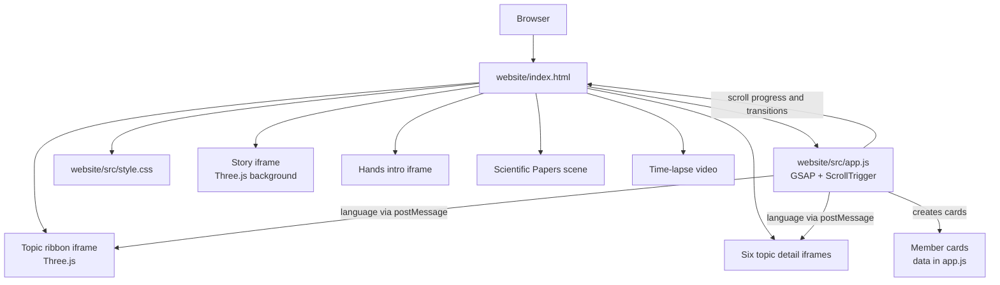

# Architecture

## Runtime model

The site is a static HTML, CSS, and JavaScript application served from the repository root. Its asset URLs begin with `/website/`. There is no build step or package manager.



## Page sequence

1. `#intro` embeds the dot-hand scene and opening title.
2. `#story` presents the MAKE LIFE BETTER slogan over the shared Story animation. Characters assemble during the scroll, then hold before the scene transitions to the topic ribbon.
3. `#topics` hosts the Three.js topic ribbon. The parent scroll track and iframe track are synchronized by forwarding ScrollTrigger progress into the iframe. The opening title and center caption reveal later in the scene. The iframe scrollbar is hidden to avoid a second scroll control.
4. `#details` first presents its centered, single-line heading in a pinned scroll track, revealed from left to right. It then presents six standalone topic pages in a pinned sequence. The parent timeline centers the active page, fades it out, and reveals the next page; scrolling upward reverses the transitions.
5. `#papers` presents the English-only Scientific Papers heading, then two pinned article stages: four papers followed by five others. Titles link to their source pages. Both transitions reverse when scrolling upward.
6. `#members` renders Executive Board, Present, and Former cards from data in `website/src/app.js`, over the continuing Story background.
7. `#story-outro` provides a short Story-only transition after the last member while the member content fades away.
8. `#love` fades in over the Story background. The video begins hidden and blurred, then resolves to its final opacity as the section settles. The Story background fades out behind it.

## Animation ownership

| Concern | Owner | Notes |
| --- | --- | --- |
| Main page reveal, section transitions, language toggle, and video playback | `website/src/app.js` | GSAP and ScrollTrigger load from local vendor files. Scroll-linked timelines track scroll directly so upward reversals respond immediately. Desktop wheel input is reduced; touch scrolling remains native. Press `9` for a slow guided scroll to the page end; press it again or start manual scrolling to cancel. |
| Scientific Papers title and article-stage transitions | `website/index.html`, `website/src/app.js`, `website/src/style.css` | The heading is its own scroll reveal. Four linked papers fade into view, then transition to five more. The paper titles and author names stay in English when the site language changes. |
| Dot hands | `website/public/scenes/intro-smart-lab.html` | Embedded in the intro. |
| Persistent Story | `website/public/scenes/smart-lab-story.html` | A single iframe sits behind the main sequence. Keep its background dark and unobtrusive. |
| Six-topic ribbon | `website/public/scenes/smart-lab-topics.html` | Three.js 0.170.0 is imported from jsDelivr through an import map. |
| Topic detail appearance and translation | `website/src/topic-detail.css`, `website/src/topic-detail.js` | Each topic page supplies its own four-step roadmap and expected project outcome. |
| Closing video | `#timelapse` in `website/index.html` | IntersectionObserver requests playback while the section is visible. |

## Communication between frames

The language button defaults to English and sends `{ type: "smart-lab-language", language }` messages to the topic ribbon and each detail iframe. Keep the message type and receiving code synchronized when changing language behavior.

## Local development

From the repository root, run:

```powershell
python -m http.server 8000 --bind 127.0.0.1
```

Then open <http://127.0.0.1:8000/website/>. Some fonts and libraries are loaded from external hosts, so those resources require a network connection.

The time-lapse MP4 is managed by Git LFS. Contributors need Git LFS installed and initialized (`git lfs install`) to fetch and update the video.
