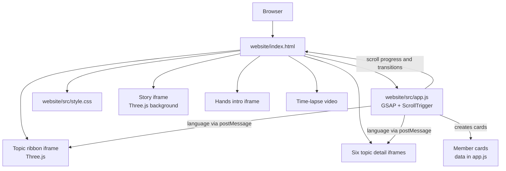

# Architecture

## Runtime model

The site is a static HTML/CSS/JavaScript project. It is served from the repository root so its `/website/...` asset paths resolve. There is no build step or package manager at present.



## Page sequence

1. `#intro` embeds the dot-hand scene and branded title.
2. `#story` presents MAKE LIFE BETTER over the shared Story animation. The phrase is split into characters and assembled during the scroll, then held before the scene fades into topics.
3. `#topics` hosts the Three.js topic ribbon. Its page track and iframe track are both 1500 viewport heights; parent-page ScrollTrigger progress is forwarded into the iframe so the ribbon advances in sync with the longer scroll. The opening title and center caption are hidden at the start and revealed later in the scene. The iframe's own scrollbar is hidden to avoid a duplicate scroll control.
4. `#details` first presents its section heading in a pinned scroll track, using a line-by-line reveal distinct from the character animation used for the MAKE LIFE BETTER slogan. It then contains six standalone HTML pages in a pinned 1500 viewport-height desktop sequence (1300 on mobile). Parent ScrollTrigger keeps each detail centered, fades it away, then reveals the next page; scrolling upward reverses the sequence.
5. `#members` renders Executive Board, Present, and Former cards from data in `website/src/app.js`, over the continuing Story background.
6. `#story-outro` leaves a short Story-only beat after the last member. The members fade away while the shared Story scene remains visible.
7. `#love` fades in over the Story background; its video begins hidden and blurred, then sharpens to its existing opacity as the ending settles in. The Story background fades out behind it.

## Animation ownership

| Concern | Owner | Notes |
| --- | --- | --- |
| Main page reveal, section transitions, language toggle, video playback | `website/src/app.js` | GSAP and ScrollTrigger are loaded from local vendor files. Scrubbed transitions reverse when scrolling upward. Wheel input is strongly reduced across the entire site on fine-pointer devices; touch scrolling remains native. |
| Dot hands | `website/public/scenes/intro-smart-lab.html` | Embedded as an iframe in the intro. |
| Persistent Story | `website/public/scenes/smart-lab-story.html` | A single iframe sits behind the main sequence; keep its background dark and unobtrusive. |
| Six-topic ribbon | `website/public/scenes/smart-lab-topics.html` | Three.js 0.170.0 is imported from jsDelivr through an import map. |
| Topic detail page appearance and translation | `website/src/topic-detail.css`, `website/src/topic-detail.js` | The six HTML pages supply their own content and tool marks. |
| Closing video | `#timelapse` in `website/index.html` | IntersectionObserver requests playback while the section is visible. |

## Communication between frames

The main language button defaults to English and sends `{ type: "smart-lab-language", language }` messages to the topic ribbon and each detail iframe. Keep the message type and the receiving code in sync when changing language behavior.

## Local development

From the repository root:

```powershell
python -m http.server 8000 --bind 127.0.0.1
```

Then open <http://127.0.0.1:8000/website/>. Some assets and fonts are loaded from external hosts; a network connection is needed for those remote resources.

The time-lapse MP4 is managed by Git LFS. Contributors need Git LFS installed and initialized (`git lfs install`) to fetch and update that video.
